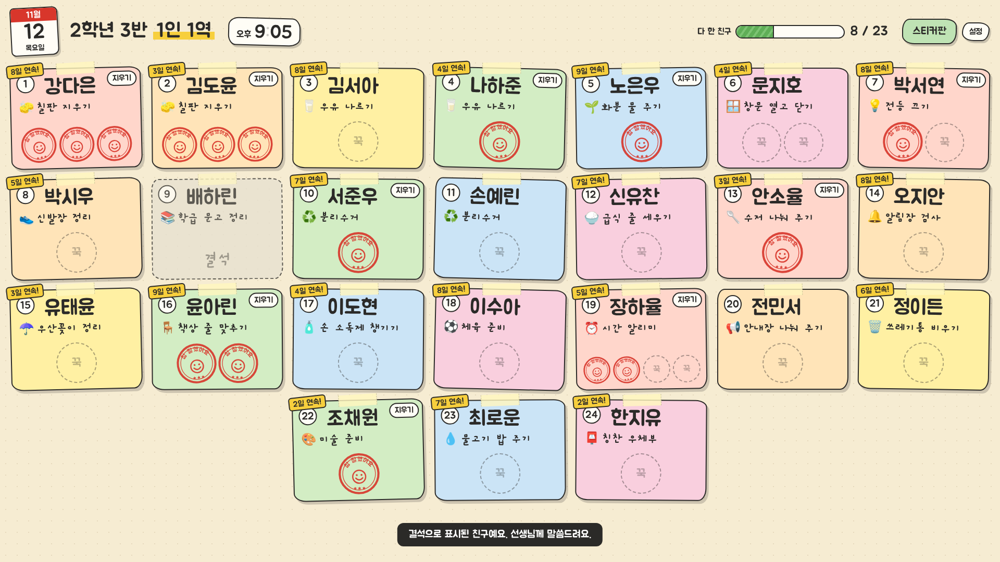

# 우리 반 1인 1역

전자칠판에 띄워 두고 학생이 자기 이름표를 터치하면 "참 잘했어요" 도장이 찍히고,
연결된 구글 스프레드시트의 오늘 날짜 칸에 ○가 저장되는 웹앱입니다.



## 할 수 있는 일

- 이름표를 누르면 도장이 찍히고 시트에 저장됩니다. [지우기]를 누르면 하나 취소됩니다.
- 하루에 여러 번 하는 역할은 횟수(1~5번)만큼 도장 칸이 생깁니다.
- 같은 역할을 두 명이 맡을 수 있습니다. 각자 자기 이름표에 도장을 찍습니다.
- 스티커판에서 이번 주 기록, 연속 일수, 이번 달 횟수, 모은 스티커를 봅니다.
- 설정(비밀번호)에서 친구와 역할 추가·삭제·변경, 오늘 결석, 쉬는 날, 스프레드시트 주소, 학급 이름, 비밀번호, 효과음을 바꿉니다.
- 여러 학급이 주소 하나를 함께 씁니다. 학급마다 스프레드시트와 비밀번호가 따로입니다.
- 토·일요일과 등록한 쉬는 날에는 쉬는 날 화면이 나옵니다.
- 인터넷이 잠깐 끊겨도 도장은 화면에 남고, 연결되면 다시 저장합니다.

## 설치 (선생님 한 분이 한 번만)

1. <https://script.google.com> 에서 **새 프로젝트**를 만듭니다.
2. `Code.gs`의 내용을 모두 지우고 이 저장소의 `apps-script/Code.gs` 내용을 붙여 넣습니다.
3. 왼쪽 **파일 +** → **HTML** → 이름을 `Index`로 만들고, `apps-script/Index.html` 내용을 붙여 넣습니다.
4. 오른쪽 위 **배포 → 새 배포** → 유형 **웹 앱** → 실행 계정 **나**, 액세스 권한 **모든 사용자** → **배포**.
5. 권한 승인 창이 나오면 허용합니다. ("확인되지 않은 앱" 경고는 **고급 → (프로젝트 이름)(으)로 이동**을 누릅니다.)
6. 나온 **웹 앱 URL**을 전자칠판 브라우저에서 엽니다.

코드를 고친 뒤에는 **배포 → 배포 관리 → 수정(연필) → 버전: 새 버전 → 배포**를 해야 반영됩니다.

## 학급 만들기 (선생님마다)

1. 웹 앱 주소를 열고 **새 학급 만들기**를 누릅니다.
2. 학급 이름과 비밀번호를 정합니다.
3. 스프레드시트 주소
   - 비워 두면 앱을 설치한 선생님의 구글 드라이브에 새 시트가 만들어집니다.
   - 자기 시트를 쓰려면 시트의 **공유 → 링크가 있는 모든 사용자 → 편집자**로 바꾼 뒤 주소를 붙여 넣습니다.
4. **설정 → 친구와 역할**에서 명단을 넣습니다. 스프레드시트의 `명단` 시트에 직접 붙여 넣어도 됩니다.
5. **설정 → 시트 · 비밀번호**에 나오는 "우리 반 바로가기 주소"를 전자칠판 즐겨찾기에 넣어 둡니다.

## 스프레드시트 모양

| 시트 | 내용 |
|---|---|
| `요약` | 맨 앞 시트. 학생 수, 오늘 다 한 친구, 결석, 이번 주·이번 달 달성률과 학생별 표(오늘, 요일별 ★, 이번 주, 이번 달, 전체 달성률, 연속, 모은 스티커). 도장을 찍을 때마다 자동으로 다시 쓰입니다. |
| `명단` | 번호, 이름, 역할, 그림, 하루 횟수 |
| `기록` | 행은 학생, 열은 날짜. 칸에는 `○`, `○○`, `결석` |
| `쉬는날` | 시작, 끝, 이름 |

`요약` 시트는 앱이 다시 쓰는 시트이므로 직접 고치지 마세요. 고칠 것은 `명단`, `기록`, `쉬는날`에서 고칩니다.

스티커 통계는 `기록` 시트에 날짜 열이 있는 날만 셉니다. 아무도 누르지 않은 날은 통계에서 빠집니다.

## 알아 둘 점

- 화면 위에 구글이 붙이는 "이 애플리케이션은 Google이 아닌 다른 사용자가 만들었습니다" 띠가 보입니다. 없앨 수 없습니다.
- 웹 앱 주소를 아는 사람은 학급 이름 목록을 볼 수 있고, 이름표를 누를 수 있습니다. 설정은 비밀번호가 있어야 합니다.
- 번호는 학생을 구분하는 열쇠입니다. 학기 중에 번호를 바꾸면 그 학생의 기록 줄이 새로 생깁니다.

## 개발자용

`test/`에는 가짜 Apps Script 환경으로 `Code.gs`와 `Index.html`을 브라우저에서 그대로 돌려 보는 검사가 있습니다.

```
node test/build-preview.js /tmp/preview.html
node test/run.js /tmp/preview.html /tmp/shots   # playwright 필요
```
